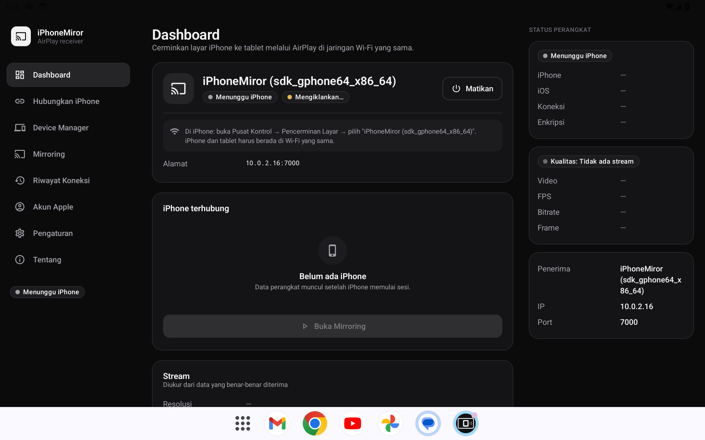
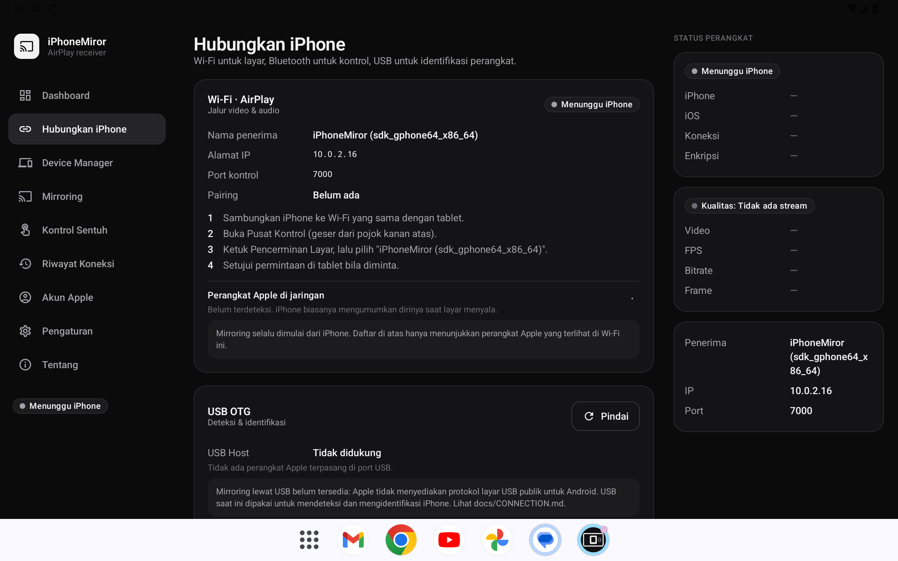
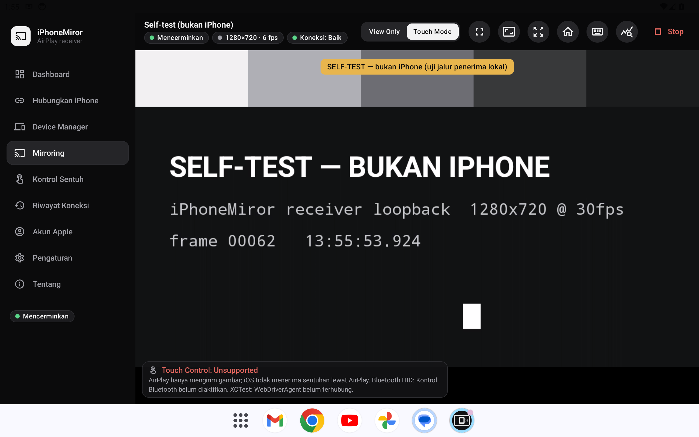
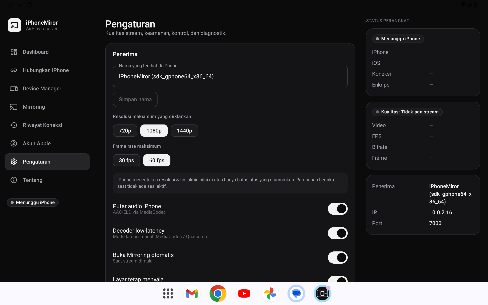
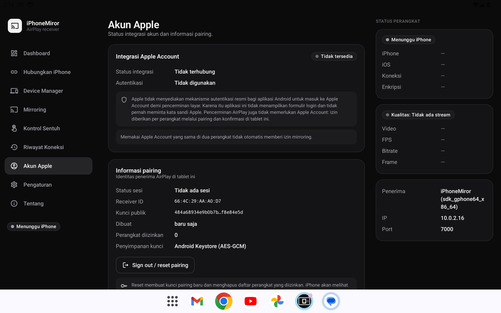
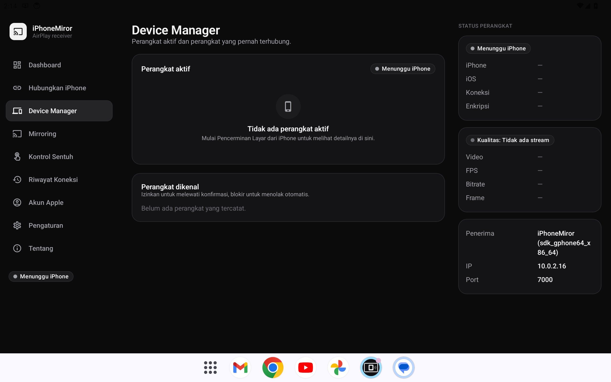

# iPhoneMiror — iPhone Screen Mirroring for Android Tablets

Aplikasi Android native (Kotlin, Jetpack Compose) yang menjadikan tablet Android — target utama
**Xiaomi Pad 6** (Snapdragon 870, Adreno 650) — sebagai **penerima AirPlay Screen Mirroring**
untuk iPhone, dengan **kontrol balik melalui Bluetooth HID**.

> Status: build & tes otomatis lulus di emulator tablet Android 14. **Belum diverifikasi dengan
> iPhone fisik** — lihat [docs/COMPATIBILITY.md](docs/COMPATIBILITY.md). Tidak ada fitur yang
> disimulasikan: semua status dan statistik berasal dari data protokol yang benar-benar diterima.

## Screenshot

Diambil otomatis oleh CI pada emulator **Pixel Tablet, Android 14, 2560×1600** (tata letak sama dengan Xiaomi Pad 6 landscape).

| Dashboard (penerima aktif) | Hubungkan iPhone |
|---|---|
|  |  |
| **Mirroring — self-test** (kartu uji lokal, *bukan* iPhone) | **Pengaturan** |
|  |  |
| **Akun Apple** | **Device Manager** |
|  |  |

Semua screenshot: [docs/screenshots](docs/screenshots).

## Cara kerja singkat

| Kebutuhan | Cara yang diimplementasikan |
|---|---|
| Layar iPhone di tablet | iPhone → Pusat Kontrol → **Pencerminan Layar** → pilih tablet (AirPlay, Wi-Fi yang sama) |
| Video | H.264 didekripsi (FairPlay) lalu di-decode hardware via **MediaCodec** langsung ke Surface |
| Audio | AAC-ELD → MediaCodec → AudioTrack low-latency |
| Sentuh langsung (real-time) | Tablet menjadi **pointer absolut Bluetooth HID** (iOS 18+, AssistiveTouch): tap, double tap, long press, swipe, drag & drop, scroll 2 jari |
| Multi-touch (pinch, 2+ jari) | **XCTest / WebDriverAgent** (alat UI-testing resmi Apple, akun developer sendiri) — lihat [docs/TOUCH_CONTROL.md](docs/TOUCH_CONTROL.md) |
| USB OTG | Deteksi, izin, dan identifikasi iPhone (UDID/produk). *Mirroring via USB tidak tersedia.* |
| Bluetooth | Discovery perangkat Apple (BLE) + kanal kontrol HID. *Bukan untuk video.* |
| Apple Account | Halaman status yang jujur — tidak ada API resmi, tidak ada login, tidak meminta password. |

## Unduh APK

Setiap push ke `main` membangun dan menerbitkan APK ke rilis
[**latest-build**](https://github.com/aldiianshr-commits/iPhoneMiror-Android-/releases/tag/latest-build):

- `iPhoneMiror-release.apk` — R8/minified, ditandatangani kunci uji publik (lihat SECURITY.md)
- `iPhoneMiror-debug.apk` — paket `com.aldiianshr.iphonemiror.debug` (bisa terpasang berdampingan)

Persyaratan: Android 13 (API 33) atau lebih baru, ARM64 (APK tanpa library native).

## Penggunaan

1. Buka aplikasi → **Dashboard → Nyalakan penerima** (notifikasi menandakan penerima aktif).
2. Pastikan iPhone dan tablet di **Wi-Fi yang sama**.
3. iPhone: **Pusat Kontrol → Pencerminan Layar → "iPhoneMiror (…)"**.
4. Setujui perangkat di tablet (pertama kali). Tampilan **Mirroring** terbuka otomatis.
5. Sentuh langsung: **Kontrol Sentuh → Aktifkan kontrol Bluetooth**, pasangkan tablet dari iPhone
   (Pengaturan → Bluetooth), aktifkan **AssistiveTouch**, lalu di Mirroring pilih **Touch Mode**.
   Bila tidak ada jalur input, aplikasi menampilkan **Touch Control: Unsupported** beserta alasannya.

Tips: jalankan **Pengaturan → Uji mandiri penerima** untuk memverifikasi jalur
Wi-Fi → dekripsi → decoder di tablet tanpa iPhone. Videonya dilabeli *SELF-TEST — BUKAN IPHONE*.

## Fitur

- Halaman: Dashboard, Hubungkan iPhone, Device Manager, Mirroring, Kontrol Sentuh, Riwayat Koneksi,
  Akun Apple, Pengaturan, Tentang
- Direct touch: View Only / Touch Mode / Fullscreen Touch, pemetaan koordinat presisi (letterbox,
  skala, zoom, orientasi), multi-touch MotionEvent, indikator sentuhan, status input & latensi respon
- Layout tablet: sidebar kiri, konten tengah, panel status kanan (≥1200 dp), landscape & portrait
- Mirroring: fullscreen, rasio (Pas/Penuh/Regang), pinch-zoom & pan, statistik live
  (resolusi, fps, bitrate, frame, decoder), kualitas koneksi terukur, Stop Mirroring
- Keamanan: persetujuan perangkat baru, izinkan/blokir, identitas pairing di Android Keystore
- Diagnostik: log dalam aplikasi yang bisa dibagikan, self-test penerima

## Struktur proyek

```
iPhoneMiror-Android-/
├── README.md · LICENSE · CONTRIBUTING.md · SECURITY.md
├── docs/               ARCHITECTURE · COMPATIBILITY · CONNECTION · ROADMAP · screenshots/
├── app/                UI Compose, ViewModel, Hilt DI, ReceiverService, self-test, tes UI/instrumentasi
├── core/               logging, util byte, info jaringan
├── domain/             model, antarmuka repository, use case (Kotlin/JVM murni)
├── data/               Room, DataStore, KeystoreIdentityStore
├── airplay-protocol/   FairPlay SAP v3, pairing, X25519 (subset java-airplay, MIT)
├── connection/         server AirPlay/RTSP, kanal mirror & audio, ReceiverController
├── mirroring/          VideoDecoderEngine (MediaCodec), AudioPlayerEngine, SpsParser
├── device-discovery/   mDNS advertise, Bonjour browse, USB OTG, BLE
├── input-controller/   Bluetooth HID keyboard/mouse
├── keystore/           kunci uji publik untuk APK rilis
└── .github/workflows/  CI: build, tes, emulator tablet, screenshot, rilis
```

Detail: [docs/ARCHITECTURE.md](docs/ARCHITECTURE.md) · [docs/CONNECTION.md](docs/CONNECTION.md)

## Build

```bash
./gradlew assembleDebug assembleRelease
./gradlew testDebugUnitTest :airplay-protocol:test :domain:test
./gradlew connectedDebugAndroidTest   # butuh emulator/perangkat
```

JDK 17, Android SDK 35. Output: `app/build/outputs/apk/{debug,release}/iPhoneMiror-*.apk`.

## Lisensi

MIT — lihat [LICENSE](LICENSE). `airplay-protocol/` berasal dari
[serezhka/java-airplay](https://github.com/serezhka/java-airplay) (MIT).
AirPlay, iPhone, iOS, dan FairPlay adalah merek dagang Apple Inc.; proyek ini tidak berafiliasi dengan Apple.
